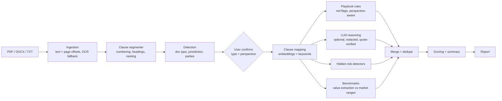

# DocuLens: Document X-Ray

DocuLens reads offer letters, employment agreements, NDAs, SaaS contracts, terms of service, privacy policies and data-protection policies. It tells you which clauses put you at risk, which risks are hidden, what is missing, and how the terms compare with market standards. Every finding points at the exact sentence in your document.

It is a hybrid system:

- **Local mode (no keys).** Structure-aware segmentation, neural clause embeddings and expert-written playbooks of red flags, market ranges and hidden-risk detectors.
- **Hybrid mode (free LLM key).** Adds clause-by-clause LLM reasoning (Groq, Gemini or OpenAI). Quotes are verified against the source text, and personal data is redacted before anything leaves the server.

> DocuLens provides automated risk analysis for information only. It is not legal advice.

## What you get

| View | What it shows |
| --- | --- |
| **Upload and confirm** | Drop a PDF, DOCX or TXT file, or paste text. DocuLens detects the document type, jurisdiction and parties. You confirm whose side you are on (for example candidate or employer), because every finding is judged from that perspective. |
| **X-Ray report** | A letter grade with category subscores and a radar chart, plus the top three things to negotiate. The document is highlighted by severity, with a heat strip for navigating long contracts. A findings rail has five tabs: Risks, Hidden, Missing, Market (sliders against market ranges) and In favor. Every market standard and range links to the trusted source it comes from (statutes, regulators, courts, professional bodies, law firms or major business news). |
| **Ask the document** | Questions answered only from the document, with clickable clause citations. |
| **Compare** | Two analyses aligned clause by clause (for example two job offers), with a verdict per clause type and benchmark deltas. |
| **History** | Every analysis is stored server-side and searchable. Results are cached by content hash. |
| **PDF report** | A shareable report with the grade, findings, quotes, recommendations and benchmarks. |
| **NLP Lab** | The classic four-layer NLP view of the same document (tokenization, POS and lemmas, TF-IDF, n-grams, readability, extraction, TextRank, obligations) for study and demonstration. |

## Quick start

Prerequisites: Python 3.11+ and Node.js 20+.

```bash
cp .env.example .env        # optional: add GROQ_API_KEY or GEMINI_API_KEY for hybrid mode
./start.sh                  # creates .venv, installs dependencies, starts API :8000 and UI :5173
```

Then open http://127.0.0.1:5173 and upload a document. The app starts empty: there are no bundled samples. Real public documents to try are in `demo_documents/` (sources and licences in `demo_documents/SOURCES.md`, a suggested walkthrough in `demo_documents/DEMO.md`).

Or run the two servers yourself:

```bash
python3 -m venv .venv && .venv/bin/pip install -r backend/requirements.txt
.venv/bin/python backend/run.py                      # API on http://127.0.0.1:8000 (docs at /docs)
cd frontend && npm install && npm run dev            # UI on http://127.0.0.1:5173
```

On first start the API downloads the `BAAI/bge-small-en-v1.5` ONNX embedding model (about 130 MB) and the NLTK data used by the NLP Lab. To skip the model download, set `DISABLE_NEURAL_EMBEDDINGS=1`; DocuLens then uses TF-IDF instead. OCR for scanned PDFs is optional (see the comments in `backend/requirements.txt`).

### Configuration (`.env`)

| Variable | Default | Purpose |
| --- | --- | --- |
| `GROQ_API_KEY` / `GEMINI_API_KEY` / `OPENAI_API_KEY` | empty | Any one enables hybrid mode. Without a key, DocuLens runs in local mode. |
| `LLM_PROVIDER` | auto | `groq`, `gemini`, `openai` or `none`. |
| `LLM_MODEL` | provider default | Defaults: `openai/gpt-oss-120b` (Groq), `gemini-2.5-flash`, `gpt-4o-mini`. |
| `LLM_FALLBACK_MODELS` | provider default | Comma-separated models tried when the main one is rate-limited or retired. Groq: `openai/gpt-oss-20b,qwen/qwen3.8-27b`. |
| `LLM_BATCH_CHARS`, `LLM_MAX_BATCHES` | `9000`, `5` | Clause text per AI request and requests per analysis. Long documents send their highest-priority clauses. |
| `LLM_CONCURRENCY`, `LLM_MAX_OUTPUT_TOKENS`, `LLM_REASONING_EFFORT` | `2`, `4096`, `low` | Parallel AI requests, output cap, and reasoning effort for `gpt-oss` models. |
| `DISABLE_NEURAL_EMBEDDINGS` | `0` | `1` uses TF-IDF only (faster, slightly less accurate clause mapping). |
| `MAX_UPLOAD_MB`, `MAX_PAGES` | `15`, `120` | Upload limits. |
| `CORS_ORIGINS` | localhost:5173 | Comma-separated origins allowed to call the API. |
| `DOCULENS_DATA_DIR` | `backend/data` | SQLite database and stored originals. |

API keys are read from the environment only and are never sent to the browser.

### Groq free tier

Check the key, the model and your current limits (the key itself is never printed):

```bash
cd backend && ../.venv/bin/python -m app.llm.check
```

On the free tier each model allows about 8,000 tokens per minute and a daily token budget. A short offer letter or NDA uses about 8,000 tokens and takes 10-40 seconds; a long agreement or policy uses 25,000-35,000 tokens and takes about 1-2 minutes. That is roughly 10-15 analyses per day. When one model is rate-limited, DocuLens switches to the next model in `LLM_FALLBACK_MODELS`. When all of them are exhausted, the remaining clauses are checked by the local rules and the report says so, with an estimate of when to retry. Such degraded results are not cached, so re-running later gets the full AI review.

## How the analysis works



1. **Ingestion** (`app/ingestion`). PyMuPDF and python-docx extract the text while keeping character offsets and page numbers, so every highlight maps back to the original. Legacy `.doc` files are rejected with a clear message.
2. **Segmentation** (`app/structure`). Numbered sections (`1.`, `1.1`, `(a)`, `Article IV`), all-caps and title-case headings, and heading hints from the PDF become nested clauses. Unstructured text falls back to paragraphs, and very long blocks are split.
3. **Detection** (`app/classify`). Document type comes from title keywords plus embedding similarity to playbook prototypes, with LLM confirmation in hybrid mode. Jurisdiction comes from weighted signals (currency, statutes, courts, cities). Parties and their roles are extracted from the preamble.
4. **Playbooks** (`app/playbooks/*.yaml`). One playbook per document type (offer letter, employment agreement, NDA, MSA/SaaS, terms of service, privacy policy, DPA/compliance, generic contract). Each one lists the clause types to look for, their market standards, numeric market ranges per jurisdiction (India, US, EU, UK), red-flag patterns stating who they hurt, hidden-risk patterns, suggested redlines and legal references. Every market standard, range and legal reference points to an entry in `app/playbooks/sources.yaml` (title, publisher, link and source type). The app refuses to start if a reference is missing, and `docs/sources_changelog.md` records every value that was corrected or removed to match the sources.
5. **Clause mapping** (`app/analysis/mapping.py`). Each clause is scored against each clause-type prototype by cosine similarity (`bge-small-en-v1.5` via fastembed, or TF-IDF), blended with keyword and heading evidence.
6. **Findings.**
   - *Rules* fire red flags only for the perspective at risk. The same clause shows as "In favor" for the other side.
   - *LLM reasoning* (hybrid mode) reviews clauses in batches against a JSON schema, with at most five of the most material findings per batch. Every quoted sentence must be found in the source by exact or fuzzy matching (rapidfuzz, score of at least 88), or the finding is dropped. An abridged quote ("A ... B") passes only if every fragment appears in order within a short span, and the report then cites that whole span verbatim.
   - *Hidden-risk detectors* catch buried clauses, terms incorporated from URLs or "as amended from time to time", missing annexures, vague discretion, one-sided obligations, auto-renewal, penalties, survival clauses, internal contradictions (for example a 90-day vs 60-day notice period) and missing expected clauses.
   - *Benchmarks* extract durations, money and percentages near the right context words, then place them against the playbook's market range for that jurisdiction. A slider appears only where a source gives a range for that jurisdiction, and it links to that source.
7. **Merge, score and summarize.** Overlapping findings are merged, and generic findings are absorbed by more specific ones. Score = `100 x e^(-sum of impacts / 100)`, where each finding's impact is its severity weight (critical 30, high 18, medium 9, low 4) times confidence. Findings are ranked from most to least severe and the k-th one counts `0.9^k`, so a long document with many minor issues is not scored like one with a few serious ones. Favorable findings count zero, and missing clauses count 0.8x. The same wording repeated elsewhere in a document (for example US and EU versions of the same terms) is reported once, citing both places.

Privacy: emails, phone numbers, ID numbers (PAN, Aadhaar, SSN), card and account numbers are always redacted before LLM calls. Strict privacy mode also redacts party names and amounts. Redactions are reversed in the results.

## API

All endpoints are under `/api`. Interactive docs are at `http://127.0.0.1:8000/docs`.

| Method and path | Purpose |
| --- | --- |
| `POST /documents` (multipart `file`) | Upload. Returns the document with its detection (type, jurisdiction, parties, perspectives). Deduplicated by content hash. |
| `POST /documents/text` | Same as upload, for pasted text. |
| `GET /documents/{id}`, `GET /documents/{id}/file` | Text, pages and clauses; the original PDF/DOCX. |
| `POST /analyses` | Start an analysis: `{document_id, doc_type?, perspective?, jurisdiction?, use_llm, privacy_mode, force}`. Returns `cached: true` on a cache hit. |
| `GET /analyses/{id}/events` | Server-sent progress events. |
| `GET /analyses/{id}`, `/status` | Full result, or status only. |
| `GET /analyses?q=&limit=` | History with search. |
| `DELETE /analyses/{id}` | Delete an analysis. |
| `POST /analyses/{id}/chat` | Ask the document; returns an answer and citations. |
| `POST /analyses/{id}/negotiation-email` | Draft an email for the selected findings. |
| `GET /analyses/{id}/report.pdf` | PDF report. |
| `GET /analyses/{id}/lab` | NLP Lab layers 1-4. |
| `POST /compare` | Compare two analyses clause by clause. |
| `GET /health`, `/meta`, `/playbooks` | Engine status (including the LLM provider, models and any cooldowns), enums, playbooks. |

## Evaluation

Run these from `backend/`.

```bash
../.venv/bin/python -m pytest                      # about 135 tests, 5 s (TF-IDF, no LLM, isolated DB)
DOCULENS_TEST_NEURAL=1 ../.venv/bin/python -m pytest
../.venv/bin/python -m eval.run_eval [--tfidf] [--llm] [--json out.json] [--strict]
../.venv/bin/python -m eval.cuad_eval --download --limit 40 [--tfidf]
../.venv/bin/python -m eval.tosdr_eval [--services 225 194 ...]     # needs internet
cd ../frontend && npx playwright install chromium && npm run test:e2e
```

- **Unit and API tests** (`backend/tests`) cover segmentation offsets and nesting, real-PDF layout handling (running headers and footers, detached clause numbers, bold headings), party extraction, value extraction, the quote verifier (fabricated quotes must be rejected), PII redaction, perspective flipping, document-scoped rule exclusions, finding de-duplication, scoring, Groq rate-limit and outage handling, the NLP Lab tokenizer, and the full HTTP flow: upload, SSE, cache, chat, email, PDF, lab, compare, history and delete.
- **Gold set** (`backend/tests/fixtures/gold/*.yaml`). Hand-labeled expectations for six internal test documents (`backend/tests/fixtures/documents/`; they are not shown in the app). Each file lists the issues a careful reviewer must raise, optional acceptable flags, known false positives that must never return, and expected benchmark values. The current engine meets all of them in both embedding modes (precision 100%, recall 100%, 0% unverifiable quotes). These samples informed the playbooks, so treat this as a regression gate, not an estimate of accuracy on unseen documents.
- **CUAD** (510 expert-annotated commercial contracts, CC BY 4.0). Checks that DocuLens clause types line up with CUAD's annotations. Results on the first 40 test contracts:

  | Clause type | Doc precision | Doc recall | Doc F1 | Span recall |
  | --- | --- | --- | --- | --- |
  | governing_law | 100% | 74% | 85% | 57% |
  | liability_cap | 88% | 88% | 88% | 42% |
  | term_renewal | 48% | 91% | 62% | 90% |
  | ip_ownership | 42% | 100% | 59% | 35% |
  | termination* | 29% | 100% | 44% | 100% |

  Macro document F1 is 68% with neural embeddings and 57% with TF-IDF. *DocuLens' `termination` type covers all termination rights, while CUAD's category is termination for convenience only, so its precision is a floor.
- **ToS;DR** (crowd-reviewed terms of service, CC BY-SA). Approved "bad" and "blocker" points are mapped to DocuLens clause types, and the live terms pages are analysed. DocuLens raised 29 of 33 mappable points (88%) across Apple, Spotify, Reddit and Dropbox. Three misses are a deliberate difference: ToS;DR counts "liability limited to fees paid" as bad, while the playbook treats that as market standard and flags only token caps. The fourth cites wording that is no longer in the live document.
- **Playwright smoke tests** (`frontend/tests/smoke.spec.js`) start an isolated API and UI. They check that the home page offers only upload and paste, then run three journeys: an uploaded offer letter through report, chat and history; an uploaded MSA read from the vendor side; and a pasted NDA through Compare.
- **Real documents** (`demo_documents/`). Thirteen public offer letters, employment agreements, NDAs, a SaaS agreement, terms of service, privacy policies and a DPA, with the per-document results recorded in `demo_documents/SOURCES.md`.

## Deployment

- **API on Render.** `render.yaml` builds `backend/Dockerfile`, mounts a persistent disk at `/data` and reads keys from Render environment variables. Set `CORS_ORIGINS` to your frontend URL.
- **UI on Vercel.** `vercel.json` builds `frontend/`. Set `VITE_API_URL` to the API's public URL (for example `https://doculens-api.onrender.com`).
- **Single host.** Run `uvicorn app.main:app` from `backend/`, then serve `frontend/dist` behind the same reverse proxy, with `/api` routed to the API.

## Project layout

```
backend/
  app/
    api/            documents, analyses (SSE, chat, email, report, lab, compare), meta
    ingestion/      PDF / DOCX / TXT parsing with offsets
    structure/      clause segmenter
    classify/       doc type, jurisdiction, parties
    playbooks/      YAML playbooks + loader
    analysis/       mapping, rules, LLM reasoner, verifier, hidden risks, benchmarks, merge, scoring, chat, compare
    llm/            provider abstraction (Groq / Gemini / OpenAI) and PII redaction
    nlp/            embeddings (fastembed, TF-IDF fallback)
    lab/            four-layer NLP Lab
    reports/        PDF report
    storage/        SQLite via SQLModel
  eval/             harness, gold scorer, CUAD and ToS;DR evaluations
  tests/            pytest suite, gold labels and internal test documents
demo_documents/     real public documents for trying the app, with SOURCES.md and DEMO.md
frontend/
  src/pages/        Landing, Analyze, Report, Lab, Compare, History
  src/components/   report workspace, progress tracker, UI kit
  tests/            Playwright smoke tests
```

## Extending

To support a new document type, add `app/playbooks/<type>.yaml`. Use an existing playbook as a template: detection prototypes, perspectives, clause specs with keywords, prototypes, market standards, metrics, red flags and redlines, plus hidden patterns. Bump its `version` so cached analyses are recomputed, then add a gold file under `tests/fixtures/gold/` for a representative document.

## Limitations

- Market ranges come from the linked sources for India, the US, the EU and the UK. They describe common practice, not legal thresholds, and other jurisdictions get no slider. `scripts/check_source_links.py` (run weekly in CI) checks that every source link still works.
- Local mode only finds risks that a playbook describes. Hybrid mode generalizes better, but it depends on the LLM, and its findings are kept only when their quotes verify.
- Scanned PDFs need the optional OCR dependencies. Image-only pages without OCR are reported as warnings.
